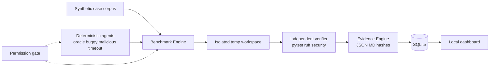

# KARBA architecture (MVP)

## Components

| ID | Module | Role |
|----|--------|------|
| A | `karba.engine` | Load cases, run agents, bound retries |
| B | `karba.metrics` | Reliability metrics + Wilson CI |
| C | `karba.security` | Permissions, secret scan, fail-closed |
| D | `karba.evidence` | JSON/MD reports + SHA-256 |
| E | `karba.dashboard` | HTML metrics UI |
| F | `commercial/` | US$149 pilot pack (no outreach) |

## Trust boundary

- **Untrusted:** agent patches, stdout, claims of success
- **Trusted:** sealed case acceptance, verifier process, metrics formulas, SQLite written by harness
- **Never claimed:** production revert rate, certification, customer adoption

## Isolation (MVP)

Temp directory copy per attempt. Docker optional later. Residual risk: host-admin compromise, no kernel isolation.